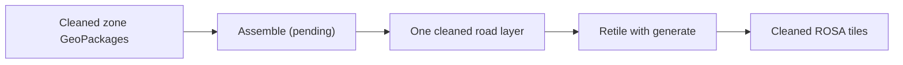

# Assemble and retile

How cleaned zones become ROSA tiles again. This step is not built yet.

!!! warning "Not built yet"
    The assembler and retiler do not exist yet and still have to be implemented (KEL-5, KEL-11). No command on this page can be run today.

Terms are defined in the [glossary](../glossary.md).

After you [hand back your zone](hand-back.md), you are done. kelviy collects every cleaned zone GeoPackage. The plan has two steps. The assembler, which is pending, reads the labels layer of every zone and joins the roads into one cleaned road layer. Then the existing `generate` command cuts that layer into tiles again, on the same grid and splits as the baseline. The result is a cleaned ROSA dataset that the models train on as before.

## How each edit is read back

The assembler reads two fields on each row of the labels layer: `raw_id` and `status`. It reads no history of your QGIS session. The saved rows are the whole record of what you did.

`raw_id` links a cleaned row to at most one raw label. Every road you did not draw yourself has the `raw_id` of the raw row it came from. A split road keeps the same `raw_id` on both pieces. Rows never merge, so no cleaned row can point at two raw rows. A road you drew has no `raw_id`.

`status` says what happens to the row:

| `status` | What the row is | In the cleaned road layer |
| --- | --- | --- |
| `kept` | A raw road you left as it is | Yes, with its raw geometry |
| `modified` | A raw road you moved or reshaped | Yes, with your geometry |
| `added` | A road you drew, or an accepted connector | Yes, with the `road_class` and buffer you chose |
| `deleted` | A raw road that is not there | No. The row stays in the zone for the statistics |
| `proposed` | A detector proposal nobody accepted | No |

The contract fixes this split. In `cleaning/contract.py`, `ROAD_STATUSES` is `kept`, `modified` and `added`, and `deleted` and `proposed` rows are not roads.

Other parts of the zone are read like this:

- **The `defect` field** does not reach the tiles. It feeds the raw versus cleaned statistics that KEL-5 plans: label revisions by status and defect, and km added, deleted and modified, per zone, split and urbanisation class.
- **Flags** never become roads. A flag holds only a location. Its `decision` feeds the detector precision report, which the review core already computes.
- **Proposals.** Accepting a proposal turns its row into `added`, and rejecting it removes the row. A proposal still `proposed` at assembly is a pending decision.
- **Tiles.** The `reviewed` field shows that someone looked at every kept tile. The assembler uses it to check that the zone is finished. `generate` decides each tile's status again from the cleaned roads.

KEL-5 says the assembler refuses a zone that has unreviewed kept tiles or pending proposals, unless it is forced. What counts as forced, and what a forced run does with those proposals, is not decided yet. Whether a pending flag that is not a proposal, or a `needs_qgis` flag, also refuses the zone is not decided yet.

For a [shared zone](../explainers/zone-assignment.md), only the owner's copy goes into the dataset. The other copies are kept for the agreement study.

## How zones become tiles again

Retiling uses no new tiling code. KEL-5 plans to pass the cleaned road layer to `generate` as its roads input, in place of the raw roads parquet. [Dataset tiling](../explainers/dataset-tiling.md) explains how `generate` works. Three of its properties keep the cleaned dataset comparable with the baseline:

- **The same grid.** `generate` cuts each zone into 512 px squares from the zone's top-left corner. The zone images do not change, so every tile lands on the same position and keeps the same name.
- **The same splits.** The split comes from the imagery folder, one split per zone. A cleaned zone stays in its train, val or test split.
- **Seams stay consistent.** Cleaning happens per zone, and the roads are cut into tiles only at the end. A road that crosses two tiles is one line in both.

`generate` then decides each tile's status again from the cleaned roads. A kept tile whose only road you deleted as a phantom becomes `dropped_no_road`. A tile can also be gained when a cleaned road reaches a tile that had none. KEL-5 plans a report of each tile's baseline status against its cleaned status, so the paper can count tiles gained and lost.

Each kept tile gets the same five artifacts as before: imagery, road mask, road lines, adjacency graph and keypoint mask. [Training data](../explainers/training-data.md) explains how the models read them. The tile format does not change, so training reads cleaned tiles the same way it reads baseline tiles.

These parts are not decided yet:

- The name of the assembler command and its flags.
- How a zone's `raw_id` stays unique once all zones are in one layer. `raw_id` is numbered from 1 in every zone.
- Which columns the cleaned road layer carries. `generate` needs at least `road_class` and `buffer`.
- Whether the cleaned dataset replaces the baseline or sits next to it.

## Why the cleaning rules matter here

The assembler trusts your rows. Two mistakes change what it reads.

**You delete a row instead of setting `status = deleted`.** The road is gone from the tiles, so the mask is still right. The label revision is lost: who removed the road, and the defect it was. The statistics also see a raw row with no cleaned row. How the assembler reports that case is not decided yet. Always set `status = deleted`. [Clean by hand](clean-by-hand.md) shows how.

**You move a road but leave `status = kept`.** The assembler takes the geometry from the row, so the moved road reaches the tiles correctly. The change is lost from the statistics, because they count revisions by `status`. The defect is lost too, since you never set it. Set `status = modified` and the `defect` yourself after every move. QGIS does not set them for you.

Two other rules protect the link back to the raw labels:

- Split a road to delete part of it, and do not redraw it. The pieces keep their `raw_id`.
- Close a gap with a new `added` connector, and do not merge two rows. A merged row would point at two raw rows.

## Weak spots

- **Pasted roads look drawn.** A road copied from the Overture layer into Labels has no `raw_id` and the status `added`. Nothing catches it yet. The [zone cleaning explainer](../explainers/zone-cleaning.md) suggests a check against Overture geometry.
- **Nothing ties the raw labels to the baseline.** The packager trusts that it was given the same roads parquet as `generate`. If it was not, the raw versus cleaned comparison is against the wrong rows.
