# GeoSAMRoad docs

These docs show you how to clean the ROSA road labels and how the pipeline behind them works.

- **[Guides](guides/setup.md)** walk you through the work, step by step. Start with [Setup](guides/setup.md).
- **[How it works](explainers/README.md)** explains how each part is built and why. Read it when you want to change a part or question a design.
- The **[Glossary](glossary.md)** defines the terms both sections use, such as zone, tile, flag and proposal.

## The cleaning flow

Kelviy packages each zone and runs the detectors. You claim a zone, review its flags and proposals with the plugin, fix the rest by hand, and upload the zone again. The assembler and retiler then turn the cleaned zones back into the ROSA dataset that the models train on. These two steps are **not built yet**.

```mermaid
flowchart LR
    raw[Raw labels<br>and imagery] --> pkg[Package zones]
    pkg --> det[Run detectors]
    det --> claim[Claim and<br>download a zone]
    claim --> review[Review with<br>the plugin]
    review --> hand[Clean by hand<br>in QGIS]
    hand --> back[Hand back<br>your zone]
    back --> asm[Assemble<br>not built yet]
    asm --> tile[Retile<br>not built yet]
    tile --> ds[ROSA dataset<br>for the models]

    classDef you fill:#d6ecff,stroke:#1f6fb2,color:#0b2a44
    classDef pending stroke-dasharray:5 5
    class claim,review,hand,back you
    class asm,tile pending
```

The blue steps are yours. The dashed steps do not exist yet.

| Step | Who | Guide |
| --- | --- | --- |
| Package zones and run detectors | kelviy, or anyone changing a detector | [Change a detector or the packager](guides/change-detector-or-packager.md) |
| Claim and download a zone | you | [Claim and download a zone](guides/claim-and-download.md) |
| Review flags and proposals | you | [Review with the plugin](guides/review-with-plugin.md) |
| Fix what is left | you | [Clean by hand in QGIS](guides/clean-by-hand.md) |
| Upload the cleaned zone | you | [Hand back your zone](guides/hand-back.md) |
| Assemble and retile | not built yet | [Assemble and retile](guides/assemble-and-retile.md) |

The files each step needs, and where to get them, are on [Data & files](guides/data-and-files.md).
